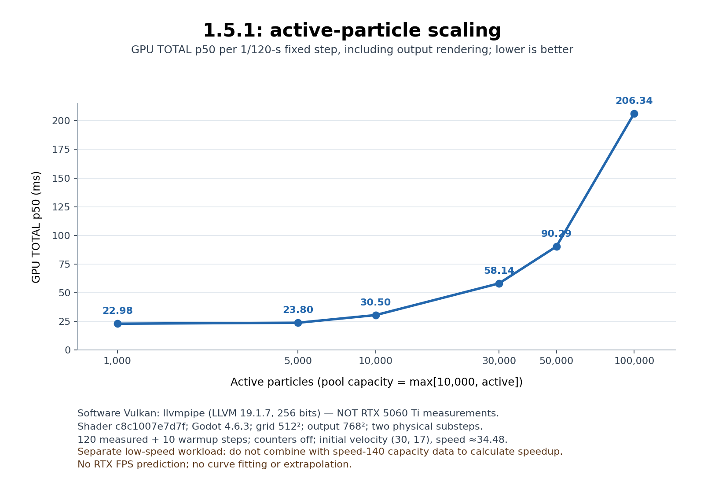
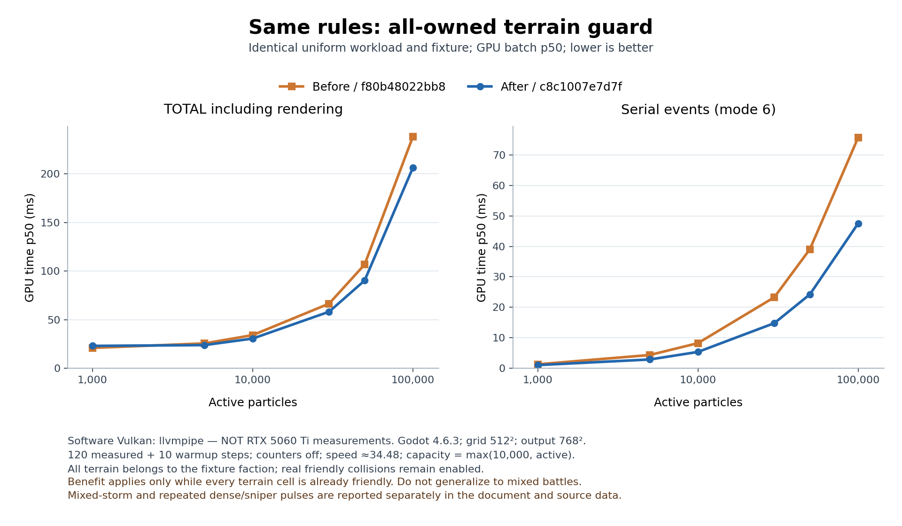
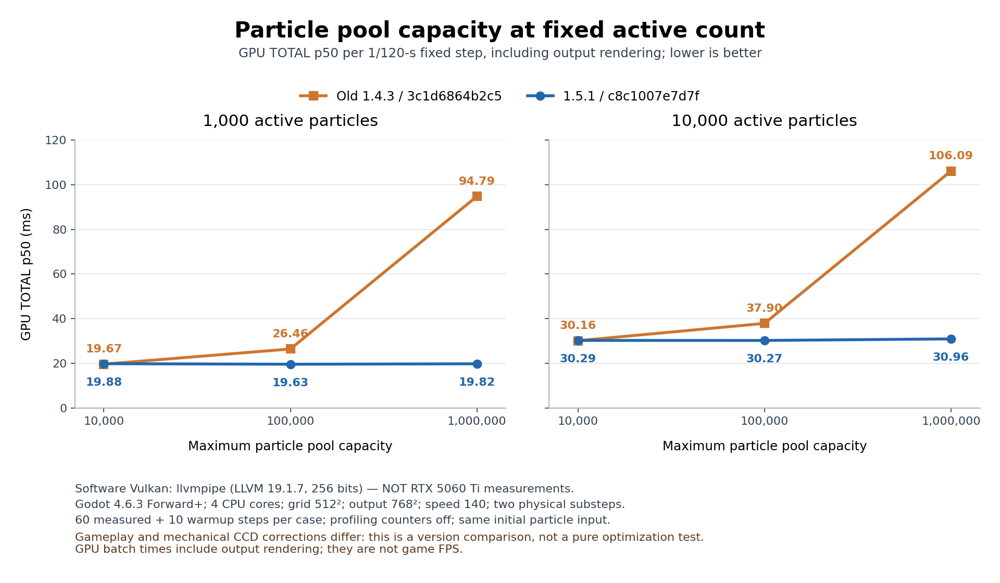
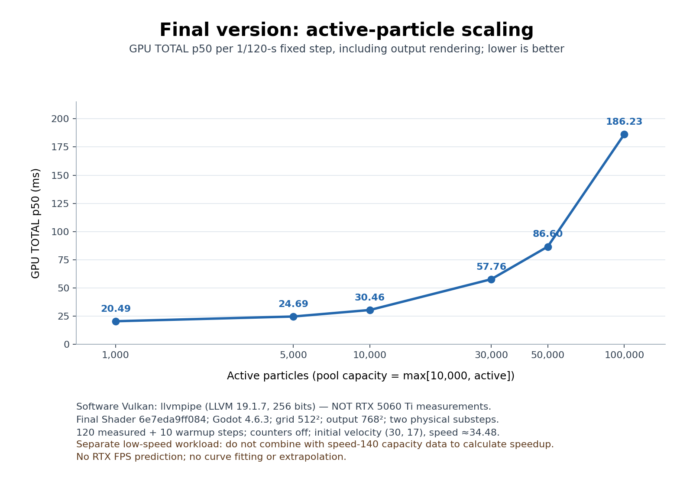
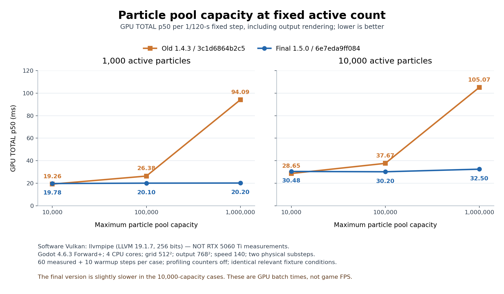

# 颜色大战1.5/1.5.1性能验证

当前1.5.1取消时间增长的发射成本，所有高能实体逐格消耗1真实能量并保留余能，机枪按剩余库存加补给在锁定时长内整数分摊；同时修复了真实墙折返与机械接触。本文保留旧性能结果，但**旧规则检查点不能作为当前1.5.1通过或提速的证据**。全部GPU数据来自软件Vulkan，不是RTX 5060 Ti实测或帧率承诺。

## 版本更新与证据适用范围

1.5.1规则与机械修复检查点Shader为 **`f80b48022bb8ac2948fae82ca71d3e074ebeb72c925268554b5f39a0f65b3aa1`**，GPUWorld为 **`73988ae98dca436c683a8db7ae3d131c4aa07514a77fae546170a7805f7c9007`**。WeaponState由128B增为160B/队，机枪新增整数商余计划与锁定时钟；时长默认10模拟秒。`artifacts/validation-1.5.1/performance/`已记录该f80检查点的44项实际性能/诊断通过，不能替代后续源码的实测。

当前正式Shader为 **`c8c1007e7d7fd6b84f6a9b87857dd5e305f25075bfdb8cb94b702a9dd1d136b1`**，host仍为上述73988。相对f80只增加一个优化：`terrain_events`逐实体读取实时面积计数，确认全图己色时跳过必然没有归属/能量写入的领土扫描，保留大球半径刷新，其余规则不变。其独立实测位于`artifacts/validation-1.5.1/performance-area-guard/`，f80完整记录保留为同规则优化前证据。该改动没有增加缓存、缓冲或CPU/GPU同步，收益不能从全己色推广到混战。

历史`b879f4b992c7…`为三处空工作快路检查点；历史`6e7eda9ff084…`为旧发射成本规则下的0.5模拟秒严格目标保持与generation检查点，均已被1.5.1规则取代。下文所有这些旧表、旧图和JSON原样保留；旧图中“Final”仅是当时6e7e检查点，**不表示当前1.5.1**。新旧规则中的真实机械修复会改变接触与后续轨迹，不能把旧新峰值耗时称为纯同玩法优化百分比。

旧默认0.08规则的1倍速长局在710.27模拟秒人工停止；6e7e默认0.5规则长局又因用户更新规则在397.533模拟秒、1752.908墙秒停止。两者均未达到要求时长，**不是长局通过**，也不能为1.5.1提供长期稳定性证明。短性能夹具与完整对局分别记录。

## 历史检查点的条件、版本与证据

Godot 4.6.3，正常窗口Forward+ / Vulkan，设备为 **llvmpipe（LLVM 19.1.7，256 bits）软件实现**。正式组关闭VSync，CPU affinity为0–3，`LP_NUM_THREADS=4`；容器CPU配额为4核时间，允许的cpuset为0–4。相同对照组保持512²领土、768²输出、相同初始粒子、半径、时间步和发射条件；运行前后记录核心源码SHA，下列历史检查点的双版本运行均退出0、无引擎错误且测试期间源码hash未变。

| 证据目录 | 对照 | 测量/预热 | 目的 |
| --- | --- | --- | --- |
| `performance-formal` | 1.4.3 → 初版1.5 | 每场景120/10，13场景 | 发现容量扫描改善与小池退步 |
| `performance-nop-optimization` | 初版1.5 → 快路径检查点1.5 | 每场景120/10，13场景 | 隔离同规则三处空工作快路 |
| `performance-final-default-speed` | 1.4.3 → 快路径检查点1.5 | 每场景60/10，6场景 | 实际出生速度140的容量复核 |
| `performance-peak-pulses` | 初版1.5 → 快路径检查点1.5 | 每场景20/3，3场景 | 每次重装输入，覆盖真实高死亡峰值与墙触分裂 |

以下历史数据的Shader SHA前缀分别为旧版 `3c1d6864b2c5`、初版1.5 `ee1e2179f3e9`、前阶段快路径检查点 `b879f4b992c7`。它们与后述`6e7eda9ff084`同属当前1.5.1之前的历史检查点。项目版本字符串不足以区分这些状态，必须使用SHA。前两组uniform出生速度为`length(30,17)≈34.48`，第三组uniform140出生速度为140；**不能跨组把不同速度或采样次数的数据拼成优化百分比**。每组内部使用相同夹具原文与参数。

前两组完整矩阵覆盖1,000、5,000、10,000、30,000、50,000、100,000活跃普通粒子，并包含相同活跃数下10,000/100,000/1,000,000容量。它们是短时压力夹具，不是20～30模拟分钟完整对局；对局稳定性须看独立长局记录。

## 时间和FPS的含义

每个矩阵样本提交一个1/120模拟秒固定步：常规为2个GPU子步，高速狙击配置2000时为6个。`TOTAL`来自RenderingDevice设备时间戳，覆盖正式固定步批次、全部子步及常规输出绘制，排除夹具初始化和统计探针；它不是仅碰撞阶段，也不是用户看到的一帧墙时。阶段数据汇总相同mode在该批全部子步的耗时，属于该dispatch相关的设备时间戳范围，不能等同纯kernel指令执行时间；各阶段中位数相加不必等于TOTAL中位数。

`drawn_fps_average`为真实绘制帧数/墙时；等待异步完成时仍可重复绘制共享纹理，因此不能用它冒充新物理状态更新频率。1%low由实际绘制帧间隔最慢1%的平均值换算，同时保留原始帧间隔样本数。**历史version 1**吞吐字段是`1000 / 样本墙时中位数`的固定步/秒估计，包含工具的异步完成等待与调度，不能与绘制FPS互换，也不是正常主循环合并多步后的游戏帧率。历史6e7e检查点改用version 2，当前1.5.1的schema 3继续保留其完整墙时分母，同时分开记录“测量步数/整个测量墙时”的实际完成吞吐与“单批墙时p50倒数”，下表不把两者混用。

CPU enqueue、render-thread submit及异步完成墙时独立记录；完成延迟含排队和帧调度，不等于CPU阻塞在GPU上的时间。工具没有显式`sync()`。驱动内部等待不可单独测得，不写成0毫秒。

## 当前1.5.1：c8正式结果与f80同规则对照

f80与c8两轮各完成5组、44次实际场景运行（各包含6次旧1.4.3基线运行），全部PASS、实际退出0、无引擎错误，正式源码与两个执行工具的前后SHA均稳定。schema 3新增规则/证据元数据与工具原文哈希；GPU计时边界和version 2完整测量墙时的吞吐分母保留，没有用单批p50倒数替代真实完成率。

| 新规则证据组 | 场景运行数 | 测量/预热 | 额外候选计数 | 适用范围 |
| --- | ---: | --- | --- | --- |
| `scale-current` | 13 | 120/10 | 关闭 | 当前规则规模、容量与持续场景 |
| `capacity-uniform140` | 旧6+新6 | 60/10 | 关闭 | 相同初态、速度140的版本容量对照 |
| `peak-current` | 3 | 20/3 | 关闭 | 每次重装的非空死亡/分裂峰值 |
| `profile-current` | 13 | 12/3 | 开启 | 15固定步累计候选诊断 |
| `peak-profile-current` | 3 | 12/3 | 开启 | 逐测量脉冲候选诊断 |

两轮对应组的夹具原文、采样次数和预热次数相同。矩阵夹具SHA为`23d9ef29da26…`，脉冲夹具SHA为`0d985e090053…`；各脉冲的完整物理重置字节SHA在f80/c8之间相同。新规则脉冲不与旧发射成本规则脉冲计算纯优化比例。环境继续是llvmpipe软件Vulkan、4核时间配额、affinity 0–3、512²领土与768²输出，非RTX实机。

### 正式规模、容量和实际绘制表现

下表全部为c8、120测量/10预热、计数关闭。uniform初速约34.48；常规每固定步2子步，fast_sniper配置2000为6子步。“完成步/墙秒”是实际完成固定步数除以完整测量墙时，不是绘制FPS。

| 场景 | 初始活跃 | 容量 | GPU TOTAL p50毫秒 | 绘制FPS / 1%low | 完成步/墙秒 | 结束活跃 |
| --- | ---: | ---: | ---: | ---: | ---: | ---: |
| uniform | 1,000 | 10,000 | 22.981 | 35.20 / 4.65 | 11.48 | 1,000 |
| uniform | 5,000 | 10,000 | 23.795 | 45.72 / 3.89 | 15.11 | 5,000 |
| uniform | 10,000 | 10,000 | 30.502 | 43.47 / 7.75 | 14.49 | 10,000 |
| uniform | 30,000 | 30,000 | 58.137 | 29.15 / 3.28 | 9.72 | 30,000 |
| uniform | 50,000 | 50,000 | 90.292 | 20.12 / 2.13 | 6.71 | 50,000 |
| uniform | 100,000 | 100,000 | 206.345 | 12.16 / 3.70 | 4.05 | 100,000 |
| uniform | 1,000 | 100,000 | 20.724 | 57.37 / 17.94 | 18.91 | 1,000 |
| uniform | 10,000 | 100,000 | 30.094 | 49.31 / 16.94 | 16.35 | 10,000 |
| uniform | 1,000 | 1,000,000 | 20.075 | 50.72 / 5.69 | 16.81 | 1,000 |
| uniform | 10,000 | 1,000,000 | 30.126 | 41.75 / 4.70 | 13.92 | 10,000 |
| dense_crossing | 1,000 | 10,000 | 20.148 | 60.51 / 20.51 | 20.11 | 1 |
| fast_sniper | 1,000 | 10,000 | 35.879 | 42.85 / 12.15 | 14.28 | 0 |
| four_storm | 1,000 | 10,000 | 38.601 | 42.47 / 10.99 | 14.16 | 5,270 |

dense_crossing与fast_sniper连续场景耗尽后仅剩1和0实体，不能据这两行宣称持续1,000实体峰值已覆盖；真正非空峰值见下节重新装填的脉冲。four_storm账本计入追加4,320输入，总核对能量5,320。所有场景整数账本通过。

[SVG](../artifacts/validation-1.5.1/performance/charts/active_particle_scaling.svg) · [完整精度CSV](../artifacts/validation-1.5.1/performance/charts/active_particle_scaling.csv)

### 同规则只增加全己色扫描早退

以下直接比较同一矩阵夹具的f80→c8。判定每颗读取实时`stat[8+own]==n²`，不跨粒子缓存；一旦出现敌色就继续原逐格扫描。它不跳过墙、粒子、大球、护盾或核心碰撞。普通/狙击全己色扫描没有状态写入；大球原有的半径刷新仍执行。

| 活跃/容量 | TOTAL f80/c8 p50毫秒 | 串行事件f80/c8 p50毫秒 |
| --- | ---: | ---: |
| 1,000/10,000 | 20.886 / 22.981 | 1.280 / 1.021 |
| 5,000/10,000 | 25.527 / 23.795 | 4.332 / 2.859 |
| 10,000/10,000 | 34.055 / 30.502 | 8.225 / 5.340 |
| 30,000/30,000 | 66.467 / 58.137 | 23.293 / 14.792 |
| 50,000/50,000 | 106.714 / 90.292 | 39.075 / 24.241 |
| 100,000/100,000 | 238.246 / 206.345 | 75.705 / 47.517 |

这组uniform全图己色且没有初始大球，保留真实友方机械碰撞。串行事件中的无效领土扫描成本降低；**不是每行TOTAL都更低**，1,000活跃小池从20.886升至22.981毫秒，尽管该行mode6较低。其它阶段、调度和样本长尾仍影响总批次与墙时，不据单阶段变化宣称全部场景提速。

[SVG](../artifacts/validation-1.5.1/performance/charts/same_rules_area_guard.svg) · [全部13场景前后CSV](../artifacts/validation-1.5.1/performance/charts/same_rules_area_guard.csv)

c8的10,000活跃小池，运动/建桶/九色碰撞/串行事件/压紧维护分别为0.973/0.704/8.924/5.340/0.392毫秒；100,000活跃为6.051/3.483/130.336/47.517/0.474。大规模时真实pair与串行事件仍昂贵，206.345毫秒设备批次、12.16绘制FPS、4.05完成固定步/墙秒是不同指标，不能互换。f80相较历史6e7e的耗时差异还包括新的机械接触修复，不能把整个跨版本变化都归因于性能优化。

### 旧1.4.3与正式c8：速度140的容量对照

本组每场景60/10、初速140，双方使用相同初态、半径、地图/输出尺寸、固定步、禁枪及CD 0.5；完整配置字典并不逐键相等：旧版缺少`growth_curve_time`、`gun_discharge_duration`、`sniper_split_angle`，新版已删除`particle_cost_delay/growth`。这些武器/成长配置不用于该普通粒子夹具，但机械响应与墙轨迹修复确实不同，所以它是版本容量比较，不能作为仅一个优化的隔离收益。

下表每项为旧1.4.3/c8正式版，吞吐均用完整测量墙时。

| 活跃 | 容量 | TOTAL p50毫秒 | 绘制FPS | 1%low | 完成步/墙秒 |
| ---: | ---: | ---: | ---: | ---: | ---: |
| 1,000 | 10,000 | 19.668 / 19.878 | 53.74 / 63.07 | 23.78 / 26.64 | 17.52 / 21.02 |
| 10,000 | 10,000 | 30.155 / 30.289 | 38.05 / 39.12 | 6.68 / 3.23 | 12.68 / 13.04 |
| 1,000 | 100,000 | 26.460 / 19.629 | 54.49 / 61.37 | 23.79 / 23.64 | 18.06 / 20.46 |
| 10,000 | 100,000 | 37.904 / 30.273 | 30.69 / 50.82 | 2.76 / 19.32 | 10.23 / 16.94 |
| 1,000 | 1,000,000 | 94.786 / 19.823 | 19.37 / 61.03 | 2.30 / 16.15 | 6.46 / 20.01 |
| 10,000 | 1,000,000 | 106.093 / 30.958 | 17.52 / 51.88 | 1.82 / 19.22 | 5.84 / 17.29 |

固定10,000活跃时，c8容量10,000/100,000/1,000,000内部对照为30.289/30.273/30.958毫秒；固定1,000活跃为19.878/19.629/19.823。普通dispatch分别稳定157或16组，含64大球槽的运动分别158或17组，避免了空池扩大导致原容量扫描成本。容量10,000小池仍有TOTAL略慢、低帧更差的行，**未实现所有条件全指标更快**。

[SVG](../artifacts/validation-1.5.1/performance/charts/capacity_comparison.svg) · [完整精度CSV](../artifacts/validation-1.5.1/performance/charts/capacity_comparison.csv)

### 混战与每次非空峰值

以下仍是同规则f80/c8，关闭额外计数；连续four_storm为120/10，三个独立脉冲为20/3。每个脉冲重新上传完整池、领土和状态，TOTAL排除上传/统计探针，脉冲工具绘制FPS含重置探针，不能当作正常游戏FPS。

| 场景 | 输入实体 | TOTAL f80/c8 p50毫秒 | 串行事件f80/c8 p50毫秒 |
| --- | ---: | ---: | ---: |
| four_storm连续 | 1,000起始 | 38.324 / 38.601 | 5.487 / 5.970 |
| dense_pulse | 1,000 | 21.284 / 20.809 | 0.580 / 0.532 |
| dense_pulse | 5,000 | 43.459 / 40.736 | 0.778 / 0.783 |
| sniper_wall_pulse | 1,000 | 57.763 / 52.873 | 7.955 / 5.166 |

four_storm并未提速；dense 5,000的mode6也略高。guard只在调用时恰好全图己色才起效，没有专门采集其命中次数，不能把混战成本变化全部归因于该分支。墙脉冲为同队友地，但仍实际触墙并分裂，未关闭墙或粒子规则。

c8的20个测量脉冲逐次满足`输入100×N=剩余+本次消耗`，实际范围为：

- dense 1,000：每次结束72实体，剩余7,100～7,101、消耗92,899～92,900、实际碰撞指标571～586。
- dense 5,000：结束185～191实体，剩余18,107～18,701、消耗481,299～481,893、实际碰撞指标3,596～3,737。
- sniper 1,000：严格结束2,000实体，1,000次墙触分裂，剩余100,000、消耗0，真实6子步继续模拟新生子弹。

新高能粒子逐格1能量后保留余能，故dense剩余远多于历史“普通粒子首格整包消耗”结果；这些是真实规则变化，旧峰值数不能用来计算新规则纯性能收益。极密并行接触次序会波动，不能将相同重置SHA解释为逐位确定的接触数或轨迹，逐次整数守恒全部实际通过。

### 计数窗口、同步与内存

c8独立profile-current计数窗口为3预热+12测量的**15固定步总差值**，不是120个primary样本，也不是每帧计数。uniform 1,000在三容量均0/0，5,000为69,489/0，10,000在三容量均730,154/0，30,000为6,878,208/172，50,000为19,979,503/446，100,000为78,646,099/5,040（候选/接触）。dense_crossing为24,101/33，four_storm为1,172,135/71,614；fast_sniper为0/0不能解释为没有墙工作。该scope不含全部墙、领土DDA、盾/核心几何。

独立peak-profile-current的**12个测量脉冲分别**记录：dense 1,000候选7,989～8,037、接触586；dense 5,000候选125,282～126,067、接触3,573～3,737、结束187～189、消耗481,493～481,693；sniper pair计数0但每次真实1,000次墙触分裂。该窗口与false峰值20脉冲分开，不能拿更窄范围覆盖上面的实际范围。计数为uint32累计差值，长期使用须模2^32处理；开计数增加原子操作，其耗时不替代false primary。

CPU与异步完成指标p50如下，均取c8规模组，单位毫秒。异步列包含队列与帧调度，**不是CPU阻塞GPU时间**。

| 活跃/容量 | CPU enqueue | render-thread submit | 异步完成墙时 |
| --- | ---: | ---: | ---: |
| 1,000/10,000 | 0.170 | 0.142 | 48.022 |
| 10,000/10,000 | 0.164 | 0.138 | 50.504 |
| 100,000/100,000 | 0.195 | 0.161 | 229.766 |

c8容量10,000/100,000/1,000,000模块申请字节为6,828,672 / 13,668,672 / 82,068,672。**allocated不是物理VRAM驻留**；真实VRAM、精确驱动内部CPU等待、目标GPU寄存器/occupancy均未测得，保留null/未测，不能写0。初始化仍需按容量清理，百万池内存没有免费。高分辨率/特效、RTX 5060 Ti与Windows原生表现须独立测量，本轮没有通过降低分辨率获得这些数据。

三张新图由[离线matplotlib脚本](../artifacts/validation-1.5.1/performance/charts/plot_performance.py)直接读取原始JSON生成，[输入、脚本及输出SHA](../artifacts/validation-1.5.1/performance/charts/plot_provenance.json)与CSV保存；无拟合、外推或推测百分比。绘图没有运行游戏或GPU，不改变历史原始记录。

## 初版1.5实际出现的退步

以下均来自同一次`performance-formal`对照，单位毫秒，格式为旧版/初版1.5。

| 活跃数 | 容量 | TOTAL p50 | mode6串行事件p50 |
| ---: | ---: | ---: | ---: |
| 1,000 | 10,000 | 19.479 / 20.315 | 1.573 / 1.318 |
| 5,000 | 10,000 | 23.368 / 25.965 | 3.515 / 4.627 |
| 10,000 | 10,000 | 29.133 / 33.155 | 5.916 / 8.822 |
| 30,000 | 30,000 | 54.042 / 66.138 | 16.642 / 25.466 |
| 50,000 | 50,000 | 83.262 / 102.701 | 27.415 / 41.874 |
| 100,000 | 100,000 | 183.177 / 218.593 | 54.401 / 83.093 |
| 10,000 | 1,000,000 | 103.749 / 32.980 | 62.964 / 8.796 |

例如10,000活跃、10,000容量时，TOTAL从29.133升至33.155，mode6从5.916升至8.822；50,000活跃时TOTAL从83.262升至102.701。不能只展示百万容量改善而忽略这些回退。

针对可证空工作，快路径检查点加入：无死亡时mode12仅刷新间接参数；无存活待分裂狙击时跳过分裂全表遍历；普通大球候选为空时跳过必然立即结束的TOI循环。非空碰撞、整数能量、领土、时间步和分辨率保持。死亡dirty使用原子置标，其高死亡密度成本另用峰值脉冲覆盖。

## 同规则三处快路前后

以下为`performance-nop-optimization`内的匹配结果。TOTAL单位毫秒；绘制FPS与1%low、吞吐均为快路径检查点工具实测。

| 活跃数 | 容量 | TOTAL 初版/快路径p50 | 快路径绘制FPS / 1%low | 快路径固定步/墙秒 |
| ---: | ---: | ---: | ---: | ---: |
| 1,000 | 10,000 | 20.399 / 19.939 | 60.99 / 20.10 | 26.60 |
| 5,000 | 10,000 | 26.246 / 24.558 | 54.63 / 21.46 | 23.35 |
| 10,000 | 10,000 | 33.779 / 30.910 | 35.82 / 4.98 | 19.08 |
| 30,000 | 30,000 | 66.966 / 57.261 | 30.07 / 4.27 | 13.04 |
| 50,000 | 50,000 | 104.030 / 86.122 | 23.11 / 3.18 | 9.42 |
| 100,000 | 100,000 | 223.377 / 203.785 | 7.86 / 0.99 | 4.23 |

10,000活跃小池的mode6从8.961降至5.825，mode12从0.737降至0.418；100,000活跃的mode6从84.176降至55.822，mode12从3.129降至0.522。这支持“移除了这些样本中的冗余工作”，不能推广为所有场景或所有硬件的加速。

该组也有回退：1,000活跃/100,000容量TOTAL为20.657→20.910；旧dense_crossing为20.069→21.613，旧fast_sniper为36.673→38.851。后两者从1,000初态最终分别只剩2和0实体，不能据此声称持续1,000实体的碰撞峰值已覆盖。四队风暴该组为40.098→37.548，但实际绘制FPS为40.83→31.57，说明TOTAL改善不能替代实际帧率结论。100,000活跃也出现TOTAL改善而绘制FPS/1%low变差的情况，原始记录保留了两类指标。

## 快路径检查点与旧版：默认出生速度140

这6组与前述低速uniform分开测量。每行条件相同，仅比较旧版/快路径检查点；所有输入与结束能量、活跃数检查通过。

| 活跃数 | 容量 | TOTAL旧/快路径p50毫秒 | 绘制FPS旧/快路径 | 1%low旧/快路径 | 固定步/墙秒旧/快路径 |
| ---: | ---: | ---: | ---: | ---: | ---: |
| 1,000 | 10,000 | 20.528 / 22.854 | 43.57 / 28.98 | 4.86 / 4.83 | 25.17 / 20.49 |
| 10,000 | 10,000 | 30.092 / 31.855 | 33.57 / 48.67 | 4.25 / 19.19 | 20.37 / 19.77 |
| 1,000 | 100,000 | 27.641 / 23.037 | 46.64 / 34.29 | 19.62 / 2.97 | 19.74 / 22.18 |
| 10,000 | 100,000 | 44.495 / 31.697 | 23.52 / 45.51 | 3.07 / 8.67 | 14.82 / 19.83 |
| 1,000 | 1,000,000 | 100.732 / 26.010 | 17.58 / 29.02 | 2.73 / 3.79 | 7.84 / 20.11 |
| 10,000 | 1,000,000 | 113.968 / 32.854 | 15.09 / 30.80 | 2.12 / 2.34 | 7.02 / 17.74 |

相同10,000活跃时，旧版容量10,000→1,000,000的TOTAL为30.092→113.968；快路径检查点为31.855→32.854。相同1,000活跃时，旧版为20.528→100.732，快路径检查点为22.854→26.010。快路径检查点间接调度组数随活跃数，运动/建桶/事件不再随空容量线性遍历；这不表示容量完全没有任何残余开销或测量波动。小池两行快路径检查点仍较慢，未达到“全部条件更快”。

下面按同一默认速度组拆主要阶段，全部为一个固定步内该阶段累计时间的p50，单位毫秒。旧版没有mode12，横线表示不存在该独立pass，不表示其相关工作免费。

| 容量（活跃均10,000） | 阶段 | 旧版 | 快路径检查点 |
| ---: | --- | ---: | ---: |
| 10,000 | 运动 | 0.945 | 1.036 |
| 10,000 | 清空间桶 | 0.830 | 0.944 |
| 10,000 | 空间索引构建 | 0.678 | 0.700 |
| 10,000 | 九色碰撞总和 | 9.091 | 9.001 |
| 10,000 | 串行事件 | 6.340 | 6.249 |
| 10,000 | 有条件压紧/调度维护 | — | 0.438 |
| 1,000,000 | 运动 | 8.164 | 1.036 |
| 1,000,000 | 清空间桶 | 0.979 | 0.935 |
| 1,000,000 | 空间索引构建 | 8.103 | 0.675 |
| 1,000,000 | 九色碰撞总和 | 10.373 | 9.528 |
| 1,000,000 | 串行事件 | 67.799 | 6.191 |
| 1,000,000 | 有条件压紧/调度维护 | — | 0.450 |

百万容量旧版的运动、建桶和串行事件均明显增加；快路径检查点这些阶段保持接近小池。地图/纹理清理及合成、九色碰撞、真实活跃实体工作仍存在。单个动态mode Shader的寄存器/私有内存是否限制目标独显，未用原生profiler确认，不能从这份软件数据直接归因。

## 每次重新制造的死亡/分裂峰值

旧dense/fast场景会在持续运行后耗尽，故新增独立`peak_load_validation.gd`。每个预热及测量脉冲均重新上传完整capacity+64粒子字节、活跃池、owner0、领土计数及禁枪/无核心目标的状态，避免旧分裂子弹成为幽灵。消耗账本与pair计数保留累计，逐脉冲计算差值。重置及前后小表探针均在TOTAL外；mode7若产生时间戳也明确剔除。

两版本的物理重置输入SHA一致。dense为48×48中心区域、四队每粒100能量、向心140；初始拥挤/重叠是明确压力输入。sniper为x1022.7、y64～960，同队每粒100能量、向右2000且配置2000，留足上下墙距离以保证一固定步只触一次右墙。后续子步继续正常模拟子弹，没有关闭碰撞以固定结果。

| 脉冲场景 | 输入实体 | TOTAL初版/快路径p50毫秒 | mode12初版/快路径p50毫秒 |
| --- | ---: | ---: | ---: |
| dense_pulse | 1,000 | 20.154 / 20.312 | 0.387 / 0.400 |
| dense_pulse | 5,000 | 37.824 / 36.586 | 0.519 / 0.540 |
| sniper_wall_pulse | 1,000 | 55.648 / 53.945 | 1.397 / 1.101 |

两版本所有20次测量及3次预热均通过每脉冲`输入100×N = 剩余 + 消耗差值`，并验证真实碰撞或指定墙触分裂：

- dense 1,000：每个脉冲从1,000实体开始，结束6～6；实际消耗99,400～99,400能量，实际pair接触528～541次。
- dense 5,000：每个脉冲从5,000实体开始，结束13～15；实际消耗498,500～498,700能量，实际pair接触3,423～3,620次。
- sniper 1,000：每个脉冲结束严格为2,000实体，实际发生1,000次分裂，总能量100,000，消耗为0；后续子步继续真实运动。

1,000 dense的TOTAL略高，5,000 dense和sniper略低；mode12在两个高死亡dense样本亦略高。dirty在并行死亡入口增加原子操作、在压紧入口增加条件检查，但这份数据没有单独隔离三处改动的贡献，不能把某个阶段的细小差异归因于原子成本。这里只是20次脉冲，不据小差异宣布精确普遍收益。没有观察到这组高死亡脉冲的明显整体退化，也不能由此证明所有高密度拓扑都更快。

该工具的实际绘制FPS与墙时包含重置、前后探针和异步等待，**仅为synthetic工具速率，不是正常游戏FPS**。跨脉冲重置会移除上一脉冲剩余实体，因此守恒断言针对每个独立脉冲，不把人工重置算作游戏能量机制。

## 候选计数、同步和内存边界

所有primary匹配性能组均关闭额外候选计数，未采集时为null，不是0候选。独立`performance-profile-current`开启计数，3预热+12测量；下面是整个15固定步窗口的累计差值，**不是**primary的120步，也不是每帧数字。

| 场景 | 初始活跃 | 容量 | 记录候选 | 记录真实接触 |
| --- | ---: | ---: | ---: | ---: |
| uniform | 1,000 | 10,000 | 0 | 0 |
| uniform | 10,000 | 10,000 | 730,154 | 0 |
| uniform | 1,000 | 100,000 | 0 | 0 |
| uniform | 10,000 | 100,000 | 730,154 | 0 |
| uniform | 5,000 | 10,000 | 69,489 | 0 |
| uniform | 30,000 | 30,000 | 6,878,208 | 172 |
| uniform | 50,000 | 50,000 | 19,979,503 | 446 |
| uniform | 100,000 | 100,000 | 78,646,099 | 5,040 |
| uniform | 1,000 | 1,000,000 | 0 | 0 |
| uniform | 10,000 | 1,000,000 | 730,154 | 0 |
| four_storm | 1,000 | 10,000 | 1,170,803 | 68,314 |

10,000活跃在三种容量下均记录730,154候选、0实际接触，支持索引工作量按真实活跃分布而非空池扩大。计数scope是`record_candidate/contact`覆盖的粒子对与大球接触路径，包括选中的狙击-大球接触；**不是全部几何查询数量**，不完整覆盖墙、领土DDA、盾/核心及所有大球TOI候选。狙击计数0不能解读为没有撞墙。累计uint32差值须按模2^32处理；开计数增加原子操作，不能用其耗时替代primary结果。

另有独立`performance-peak-profile-current`，仅快路径检查点开启计数，3预热+12测量全部通过。下表是**12个测量脉冲各自的差值范围**，不是前述false primary的20个脉冲，也不是15步连续矩阵：

| 脉冲 | 输入实体 | 每脉冲记录候选 | 每脉冲记录接触 |
| --- | ---: | ---: | ---: |
| dense_pulse | 1,000 | 7,489～7,508 | 540 |
| dense_pulse | 5,000 | 121,763～122,408 | 3,481～3,616 |
| sniper_wall_pulse | 1,000 | 0 | 0 |

这组dense 5,000结束14～15实体，耗498,500～498,600；不能用它覆盖false primary的13～15/498,500～498,700范围。狙击依然每脉冲真实分裂1,000次并结束2,000实体、100,000总能量，0候选/接触再次说明该计数没有统计墙触。开启计数的时间不与关闭计数的primary拼接作性能对照。

快路径检查点容量10,000/100,000/1,000,000的模块申请字节分别为6,828,544 / 13,668,544 / 82,068,544，包含缓冲及输出纹理；它们**不是物理VRAM驻留**。显存仍随capacity增加，初始化仍需清容量；活跃调度优化并没有让百万池免费。物理VRAM、GPU原生寄存器/occupancy和精确驱动内部同步等待未测得，保留null或明确未测。

实际GPU时间戳、绘制帧间隔和工具吞吐各自保留；极低1%low与长尾说明环境存在抖动，不能仅用中位数掩盖。原生RTX 5060 Ti应以相同条件复测，并单独评估高分辨率/特效成本；本轮没有通过降低分辨率来制造上述结果。

## 历史1.5.0检查点：0.5模拟秒严格目标保持与槽位generation

本节及其中标注“Final”的旧图仅对应历史Shader `6e7eda9ff084d4971432c838ffe8a042d0abcf5ef23d2a21f1c3688feeedc173`、GPUWorld `37e131f9bc9ce863aae8a6851fe263346e26ba43f06e7062aa99f6b01554bd3d`。`performance-final-0.5-generation/scale-current`的13场景均为实际运行PASS，退出0，无引擎错误，运行前后核心源码SHA一致；每场景120测量步、10预热步，额外候选计数关闭。每场景整数账本通过，不把未采集的候选数当作0。

夹具为version 2、SHA `30b4d8a35d16c1f1da2c3cd8eb612f9a083b930b3f490c24684dce48a17269b3`，显式固定目标切换CD为0.5。uniform初速仍为`length(30,17)≈34.48`；其余硬件、窗口、渲染尺寸与采样定义如前。**这是6e7e历史检查点的独立规模记录，不与旧版本不同夹具的13场景数字拼接计算优化百分比。**

下表“完成步/墙秒”采用`completed_fixed_steps_per_wall_second`：测量固定步数除以完整测量区间墙时，包含时间戳收集所需帧和异步调度；不使用单批p50倒数。绘制FPS同样是工具实际窗口绘制速率，不能解释为这些物理步实时达到相同帧率。

| 场景 | 初始活跃 | 容量 | TOTAL p50毫秒 | 绘制FPS / 1%low | 完成步/墙秒 | 结束活跃 |
| --- | ---: | ---: | ---: | ---: | ---: | ---: |
| uniform | 1,000 | 10,000 | 20.495 | 47.68 / 5.26 | 15.76 | 1,000 |
| uniform | 5,000 | 10,000 | 24.691 | 44.25 / 4.38 | 14.67 | 5,000 |
| uniform | 10,000 | 10,000 | 30.463 | 49.17 / 16.59 | 16.34 | 10,000 |
| uniform | 30,000 | 30,000 | 57.763 | 29.92 / 4.55 | 9.97 | 30,000 |
| uniform | 50,000 | 50,000 | 86.604 | 21.39 / 2.98 | 7.13 | 50,000 |
| uniform | 100,000 | 100,000 | 186.228 | 13.57 / 4.27 | 4.52 | 100,000 |
| uniform | 1,000 | 100,000 | 20.557 | 58.10 / 18.18 | 19.37 | 1,000 |
| uniform | 10,000 | 100,000 | 30.555 | 40.55 / 3.80 | 13.52 | 10,000 |
| uniform | 1,000 | 1,000,000 | 21.124 | 41.77 / 5.97 | 13.85 | 1,000 |
| uniform | 10,000 | 1,000,000 | 31.158 | 39.42 / 5.12 | 13.14 | 10,000 |
| dense_crossing | 1,000 | 10,000 | 20.237 | 63.27 / 28.47 | 21.09 | 2 |
| fast_sniper | 1,000 | 10,000 | 36.240 | 45.33 / 18.28 | 15.11 | 0 |
| four_storm | 1,000 | 10,000 | 35.977 | 42.26 / 15.94 | 14.09 | 5,270 |

常规场景每固定步2子步，fast_sniper为6子步。dense_crossing和fast_sniper结束时仅剩2和0实体，不能声称表中的120个样本持续承受1,000实体碰撞；重新装填的峰值脉冲另行记录。four_storm账本包括额外发射命令输入，总核对能量为5,320，不能只拿初态1,000能量与末态直接比较。

6e7e历史检查点相同10,000活跃、容量10,000/100,000/1,000,000的TOTAL为30.463/30.555/31.158毫秒；相同1,000活跃为20.495/20.557/21.124。空容量不再对应旧版全表扫描式增长；仍有真实活跃工作、固定地图/输出成本和测量波动。各组实际墙时吞吐与低帧表现有差异，不能只依TOTAL近似就称三种容量的实际绘制体验相同。

同一组主要阶段p50如下，单位毫秒，均为一个正式固定步内全部子步的阶段累计：

| 活跃数/容量 | 运动 | 空间索引构建 | 九色碰撞 | 串行事件 | 有条件压紧/调度维护 |
| --- | ---: | ---: | ---: | ---: | ---: |
| 1,000/10,000 | 0.443 | 0.399 | 4.702 | 1.028 | 0.370 |
| 10,000/10,000 | 0.991 | 0.689 | 8.428 | 5.867 | 0.397 |
| 10,000/1,000,000 | 1.011 | 0.683 | 8.593 | 5.904 | 0.432 |
| 100,000/100,000 | 6.458 | 3.406 | 105.114 | 52.496 | 0.470 |

100,000活跃时九色碰撞和串行事件仍占主要时间，当前llvmpipe不能按120个固定步/墙秒实时推进该压力输入；13.57绘制FPS也不代表13.57个完整游戏模拟秒/墙秒。当前记录未测原生RTX显卡性能，不能承诺5060 Ti帧率。

下图仅绘制本节初速约34.48的uniform规模数据，容量取`max(10,000, 活跃数)`；不与下一节速度140的容量夹具混合。

[矢量图SVG](../artifacts/validation-1.5/performance-final-0.5-generation/charts/active_particle_scaling.svg) · [完整精度CSV](../artifacts/validation-1.5/performance-final-0.5-generation/charts/active_particle_scaling.csv)

### 旧版与6e7e历史检查点：默认速度140的匹配容量对照

`capacity-uniform140`对旧版1.4.3和当时的6e7e各运行6场景，每场景60测量步、10预热步，双方均PASS/退出0、核心源码前后SHA稳定。共享version 2夹具原文，双方显式使用CD 0.5、普通粒子初速140；粒子数量、位置、半径、能量、同阵营碰撞、地图/输出尺寸和固定步相同，禁枪。旧版配置没有新版的`growth_curve_time`与`sniper_split_angle`两个键，这两个参数不用于该普通粒子夹具；不宣称两份完整配置字典逐键相等。

以下每项为旧版/6e7e历史检查点；“完成步/墙秒”均为version 2完整测量区间的实际完成吞吐，与历史表的单批p50倒数口径不同。

| 活跃数 | 容量 | TOTAL p50毫秒 | 绘制FPS | 1%low | 完成步/墙秒 |
| ---: | ---: | ---: | ---: | ---: | ---: |
| 1,000 | 10,000 | 19.257 / 19.776 | 39.71 / 63.27 | 17.56 / 29.04 | 13.24 / 21.09 |
| 10,000 | 10,000 | 28.654 / 30.476 | 48.61 / 51.24 | 16.87 / 20.04 | 16.20 / 17.08 |
| 1,000 | 100,000 | 26.385 / 20.096 | 46.03 / 63.37 | 15.51 / 26.75 | 15.34 / 21.12 |
| 10,000 | 100,000 | 37.667 / 30.204 | 43.32 / 53.27 | 15.62 / 22.12 | 14.44 / 17.76 |
| 1,000 | 1,000,000 | 94.095 / 20.200 | 23.67 / 59.71 | 8.60 / 11.44 | 7.89 / 19.68 |
| 10,000 | 1,000,000 | 105.067 / 32.501 | 21.52 / 45.36 | 7.29 / 8.28 | 7.17 / 15.12 |

这次匹配实测仍未全面提速：10,000容量小池两行的TOTAL略慢于旧版，虽然该组实际绘制FPS和完整区间吞吐较好。扩大空池时旧版TOTAL明显上升，6e7e版上升较小；相同10,000活跃，容量10,000→1,000,000为旧版28.654→105.067毫秒、6e7e版30.476→32.501毫秒。不能从GPU中位数单独推导绘制FPS、低帧或吞吐的变化比例。

[矢量图SVG](../artifacts/validation-1.5/performance-final-0.5-generation/charts/capacity_comparison.svg) · [完整精度CSV](../artifacts/validation-1.5/performance-final-0.5-generation/charts/capacity_comparison.csv)。两张图均由[离线matplotlib脚本](../artifacts/validation-1.5/performance-final-0.5-generation/charts/plot_performance.py)读取已有JSON生成；[来源与输出SHA](../artifacts/validation-1.5/performance-final-0.5-generation/charts/plot_provenance.json)一并保存。未重新运行游戏或GPU测试，图中没有拟合、外推或推测百分比。

同组活跃均10,000时的主要阶段如下，单位毫秒，格式为旧版/6e7e历史检查点；旧版无独立mode12，横线表示不存在该pass。

| 容量 | 运动 | 清空间桶 | 空间索引构建 | 九色碰撞 | 串行事件 | 有条件压紧/调度维护 |
| ---: | ---: | ---: | ---: | ---: | ---: | ---: |
| 10,000 | 0.892 / 1.007 | 0.796 / 0.870 | 0.647 / 0.655 | 8.504 / 8.545 | 6.152 / 5.992 | — / 0.406 |
| 1,000,000 | 7.848 / 0.977 | 0.890 / 0.948 | 7.240 / 0.680 | 8.886 / 9.279 | 63.478 / 6.031 | — / 0.399 |

百万池的运动、建桶和串行事件空容量开销明显降低；九色真实碰撞并未因此免费，百万池6e7e版本在本组该阶段略慢。当前普通间接组数在三种容量下始终为1,000活跃16组、10,000活跃157组；含64大球槽的运动组数分别17/158组。模块申请内存仍随容量增长，不能把调度成本降低误称为显存零开销。

### 6e7e历史检查点的重复峰值对照

`performance-final-0.5-generation/peak-pulses`重新对比初版1.5中间快照`ee1e2179f3e9…`与历史`6e7eda9ff084…`，双方3场景、各20测量脉冲+3预热，全部PASS/退出0、核心源码SHA稳定。主夹具SHA为`30b4d8a35d16…`，脉冲夹具SHA为`767266159d88…`；该次在双方显式固定CD 0.5，不覆盖旧峰值归档。三场景各自的物理重置字节SHA在两版本之间相同，几何、真实规则与探针/TOTAL边界沿用前述脉冲定义。

| 脉冲 | 输入实体 | TOTAL p50中间版/6e7e毫秒 | mode12 p50中间版/6e7e毫秒 |
| --- | ---: | ---: | ---: |
| dense_pulse | 1,000 | 20.591 / 22.531 | 0.369 / 0.386 |
| dense_pulse | 5,000 | 36.557 / 35.900 | 0.518 / 0.499 |
| sniper_wall_pulse | 1,000 | 55.233 / 56.411 | 1.325 / 1.140 |

该次dense 1,000与sniper的TOTAL较慢，dense 5,000较快；不能宣称高死亡或分裂场景一致提速，也不据20次样本宣布普遍百分比。mode12改善或退步不代表总批次必然同向变化，仍须保留真实碰撞和其他阶段成本。该对照没有单独隔离dirty原子操作、generation或其他单项的贡献。

两版本全部测量脉冲均满足整数账本与形状断言。**本次20个测量脉冲**的合并范围如下，不套用旧b879数据范围：

- dense 1,000：每次初始1,000、结束6，剩余600、消耗99,400；实际碰撞指标差值515～540。
- dense 5,000：每次初始5,000、结束12～15，剩余1,200～1,500、消耗498,500～498,800；实际碰撞指标差值合并2,898～3,617（中间版3,399～3,616，6e7e版2,898～3,617）。
- sniper 1,000：每次初始1,000、结束2,000，严格发生1,000次墙触分裂，剩余100,000、消耗0；每次仍用6个真实子步。

极密并行建链/接触处理存在顺序波动，不能将相同重置SHA解释为逐位确定的轨迹或接触次数；逐脉冲整数守恒均实际通过。未开启额外候选计数时，上述接触数来自生产`collision_metric_delta`；额外候选/确认接触字段仍为null。脉冲绘制FPS与墙时含上传和探针，仍只属于synthetic工具速率，不是正常游戏帧率。

### 6e7e历史检查点的独立候选诊断

历史6e7e的`profile-current`为13场景、3预热+12测量、`profiling=true`，全部实际PASS/退出0且6e7e/37e131源码前后稳定。下表累计窗口是**包含预热的15固定步**，不属于false primary的120个测量样本：

| 场景 | 初始活跃/容量 | 记录候选 | 记录接触 | 结束活跃 |
| --- | --- | ---: | ---: | ---: |
| uniform | 1,000/10,000 | 0 | 0 | 1,000 |
| uniform | 5,000/10,000 | 69,489 | 0 | 5,000 |
| uniform | 10,000/10,000 | 730,154 | 0 | 10,000 |
| uniform | 30,000/30,000 | 6,878,208 | 172 | 30,000 |
| uniform | 50,000/50,000 | 19,979,503 | 446 | 50,000 |
| uniform | 100,000/100,000 | 78,646,099 | 5,040 | 100,000 |
| dense_crossing | 1,000/10,000 | 24,640 | 21 | 48 |
| fast_sniper | 1,000/10,000 | 0 | 0 | 0 |
| four_storm | 1,000/10,000 | 1,170,320 | 68,473 | 2,824 |

其余四行容量复核中，1,000活跃/100,000或1,000,000容量仍为0候选/0接触；10,000活跃/100,000或1,000,000容量仍为730,154候选/0接触。候选量由实际空间分布决定，不随空容量增加。100,000活跃产生约7,865万候选而仅记录5,040次接触，说明即使避免全池空扫，邻域候选筛选仍有真实成本；不能直接删掉这些查询而假设全部不影响未来碰撞。计数scope仍不完整包括墙、领土、盾/核心几何，不能拿fast_sniper的0解释为没有碰撞工作。

历史6e7e的`peak-profile-current`另有3场景、3预热+12测量，全部PASS/退出0、核心源码SHA稳定。下表是**12个测量脉冲各自的计数差值范围**，与上表15步累计及false峰值20个测量脉冲分开：

| 脉冲 | 输入实体 | 每脉冲记录候选 | 每脉冲记录接触 | 结束活跃 |
| --- | ---: | ---: | ---: | ---: |
| dense_pulse | 1,000 | 7,314～7,508 | 515～540 | 6 |
| dense_pulse | 5,000 | 121,776～122,509 | 3,490～3,616 | 14～15 |
| sniper_wall_pulse | 1,000 | 0 | 0 | 2,000 |

dense 1,000各脉冲消耗99,400；dense 5,000消耗498,500～498,600，与false对照的更宽范围分开保留。sniper每次仍真实发生1,000次墙触分裂，总剩余能量100,000、消耗0，pair计数0符合其scope。全部测量脉冲逐次整数守恒。**这些开启额外原子计数的耗时不替换或拼接到关闭计数的正式性能表。**

## 原始记录与复核入口

- [1.5.1正式c8的44项总索引](../artifacts/validation-1.5.1/performance-area-guard/SUMMARY.json)
- [1.5.1同规则f80优化前44项总索引](../artifacts/validation-1.5.1/performance/SUMMARY.json)
- [c8正式13场景逐样本数据](../artifacts/validation-1.5.1/performance-area-guard/scale-current/current_matrix.json)
- [旧1.4.3与c8正式速度140容量比较](../artifacts/validation-1.5.1/performance-area-guard/capacity-uniform140/comparison.json)
- [c8正式非空峰值逐脉冲数据](../artifacts/validation-1.5.1/performance-area-guard/peak-current/current_matrix.json)
- [c8正式15步候选诊断](../artifacts/validation-1.5.1/performance-area-guard/profile-current/current_matrix.json)
- [c8正式逐脉冲候选诊断](../artifacts/validation-1.5.1/performance-area-guard/peak-profile-current/current_matrix.json)
- [初版formal比较](../artifacts/validation-1.5/performance-formal/comparison.json)
- [同规则快路比较](../artifacts/validation-1.5/performance-nop-optimization/comparison.json)
- [默认速度旧版/快路径比较](../artifacts/validation-1.5/performance-final-default-speed/comparison.json)
- [重复峰值脉冲比较](../artifacts/validation-1.5/performance-peak-pulses/comparison.json)
- [独立短窗候选诊断](../artifacts/validation-1.5/performance-profile-current/current_matrix.json)
- [独立峰值计数诊断](../artifacts/validation-1.5/performance-peak-profile-current/current_matrix.json)
- [历史6e7e的13场景原始记录](../artifacts/validation-1.5/performance-final-0.5-generation/scale-current/current_matrix.json)
- [历史6e7e的13场景源码、夹具与运行核对](../artifacts/validation-1.5/performance-final-0.5-generation/scale-current/comparison.json)
- [旧版与历史6e7e的默认速度容量对照](../artifacts/validation-1.5/performance-final-0.5-generation/capacity-uniform140/comparison.json)
- [历史6e7e重新测量的峰值对照](../artifacts/validation-1.5/performance-final-0.5-generation/peak-pulses/comparison.json)
- [历史6e7e的短窗候选诊断](../artifacts/validation-1.5/performance-final-0.5-generation/profile-current/current_matrix.json)
- [历史6e7e的逐脉冲候选诊断](../artifacts/validation-1.5/performance-final-0.5-generation/peak-profile-current/current_matrix.json)

各目录保留baseline/current原始JSON、日志、夹具原文及源码SHA。后续优化候选和未测假设见[后续性能路线与未测假设](后续性能路线与未测假设.md)；缓冲与同步口径见[GPU活跃粒子索引](GPU活跃粒子索引.md)。
